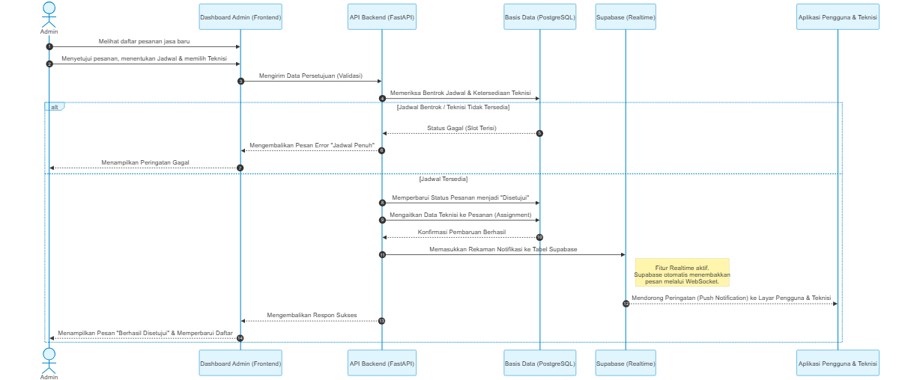
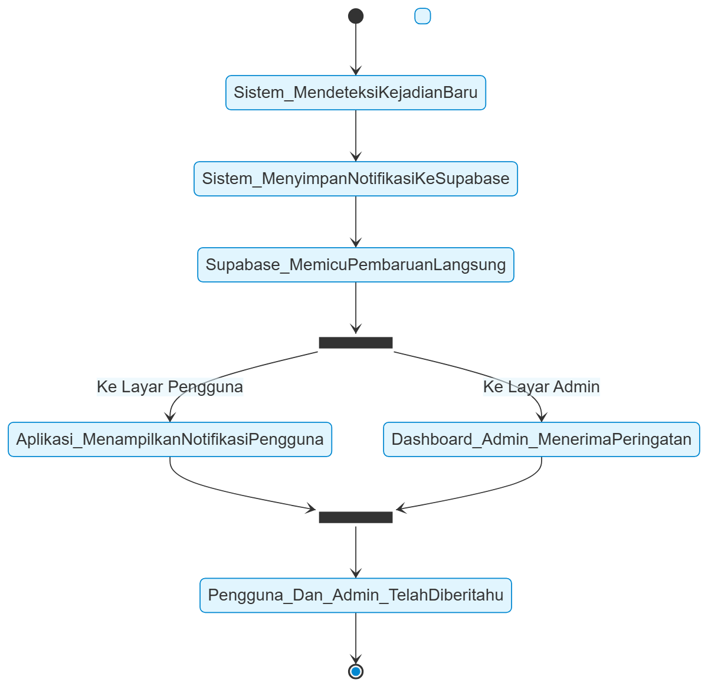

# Manajemen Penjadwalan Jasa Pemasangan (Service Booking Validation)

Salah satu fungsi krusial yang menguras lalu-lintas jaringan paling rawan di dalam kerangka kerja Admin adalah intervensi persetujuan Jadwal Kunjungan Teknisi Pemasangan (*Service Bookings*). Mesin ini dirancang untuk mendeteksi perpecahan waktu (*time-overlap*) para staf lapangan.

## Alur Resolusi Jadwal (Admin Handler Dataflow)
Setiap pesanan kunjungan Jasa Pemasangan CCTV yang diajukan pelanggan akan menyelonong masuk ke meja Dashboard Admin dengan cap status awal **"Menunggu Konfirmasi"**.

1. **Aksi Antarmuka**: Staf admin menekan tombol "Validasi" di baris data (*Data Table*).
2. **Ping Server**: Panel klien Vue menembakkan instruksi RESTful `POST` rahasia ke `FastAPI` (misal rute `/api/admin/services/{id}/validate`).
3. **Pemeriksaan Silang (DB Collision Check)**: Fungsi pengontrol (*backend handler*) melakukan kueri asinkron (*non-blocking*) ke PostgreSQL untuk meredam risiko teknisi ganda (*overbooking*) pada jam blokir yang identik.
4. **Finalisasi & Delegasi Notifikasi**: Jika jam diizinkan dan lolos pengecekan perpecahan, data kerangka waktu teknisi akan dikunci permanen, dan pelatuk penembak Notifikasi *Push Realtime* ditekan lewat WebSocket FastAPI yang dijembatani Redis pub/sub.

  
*(Diagram Spesifikasi Teknis: Alur Proses Resolusi Validasi Modul Jasa oleh Staf Admin)*

## Jaringan Laba-laba WebSocket (Realtime Broadcast)
Standar emas UX mewajibkan pembaruan informasi tanpa penundaan. Ketimbang merancang dasbor dengan teknik penarikan mundur (*Polling*) kuno, kita menggunakan arsitektur aliran *Event Injection* konstan milik WebSocket FastAPI (`/ws/notifications/{uuid}`).

* **Kelebihan Ekstrem Pola Ini**: Pelanggan atau teknisi lapangan (di aplikasi seluler) tidak harus me-*refresh* peramban mereka untuk mendeteksi apakah pesanan mereka disetujui. Sinyal kilat asinkron akan mendarat di kerangka kerja UI Nuxt milik pelanggan hanya dalam hitungan sepersekian detik.

  
*(Peta Alur Kerja: Arus Distribusi Notifikasi Sinyal Sesaat via WebSocket FastAPI)*
