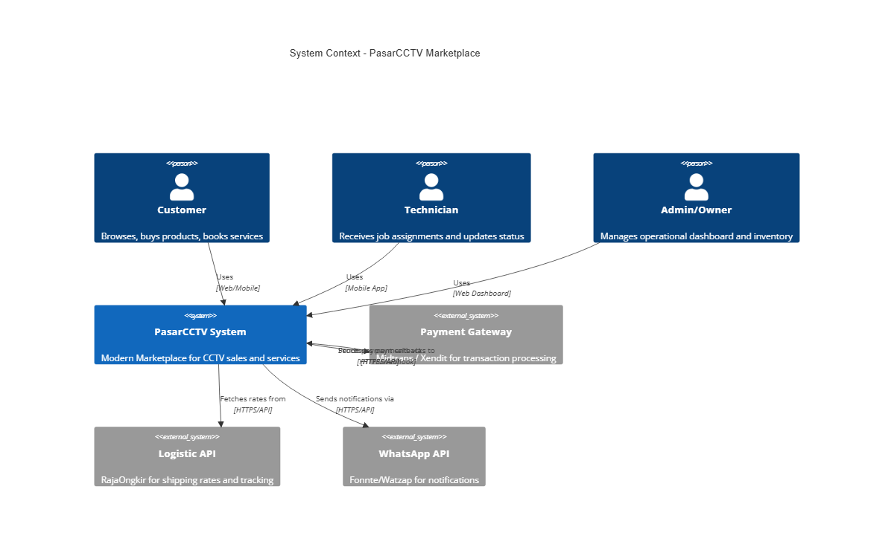
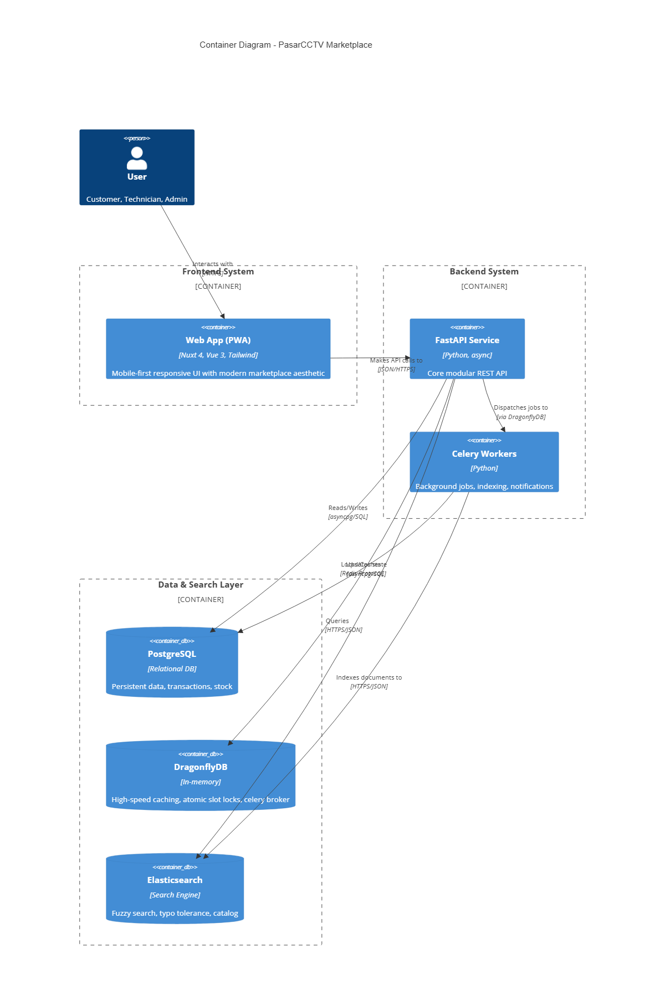
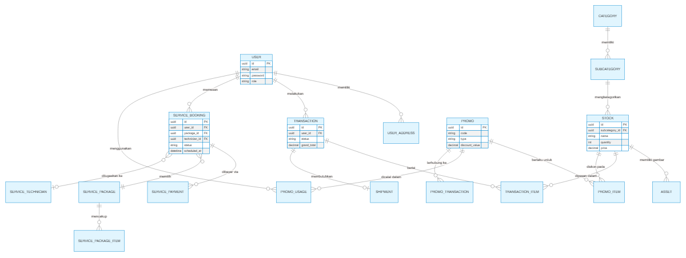
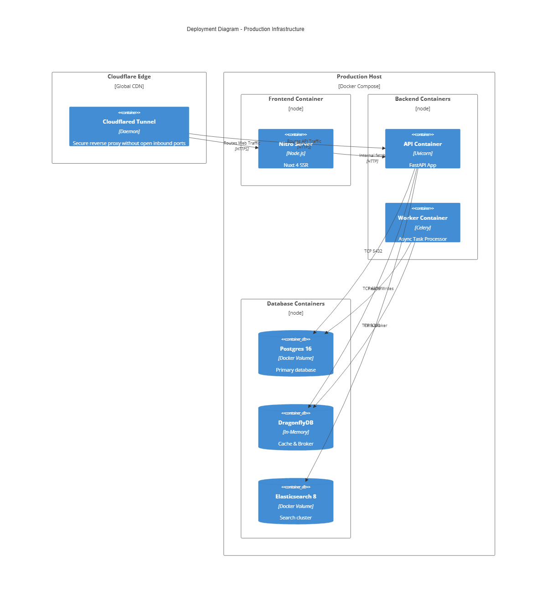

# Gambaran Sistem & Arsitektur (System Overview)

PasarCCTV dirancang dengan pola *Decoupled System* asinkron untuk memastikan kecepatan, keamanan, dan keandalan tingkat perusahaan (*Enterprise-Grade*).

## 1. Diagram Konteks C4
Diagram berikut menunjukkan bagaimana pengguna, teknisi, dan pihak eksternal (layanan pembayaran, kurir) berinteraksi dengan batas luar sistem PasarCCTV.

  
*(Lihat kode spesifikasi: [c4-context.md](./c4-context.md))*

---

## 2. Container Diagram (Microservices)
Sistem dipecah menjadi beberapa wadah (*containers*) fungsional yang saling berkomunikasi melalui protokol yang aman. Ini mencakup ekosistem *Frontend*, *Backend*, dan *Workers*.

  
*(Lihat kode spesifikasi: [c4-containers.md](./c4-containers.md))*

---

## 3. Database Entity Relationship Diagram (ERD)
Skema basis data relasional kami dikelola di PostgreSQL, yang mengelompokkan bisnis ke dalam lima pilar (domain) utama: *User/Auth*, *Produk/Katalog*, *Transaksi Fisik*, *Jasa/Pemasangan*, dan *Promosi*.

  
*(Lihat kode spesifikasi: [erd-core-marketplace.md](./erd-core-marketplace.md))*

---

## 4. Topologi Jaringan & Deployment
Aplikasi ini dikontainerisasi seluruhnya secara independen menggunakan **Docker Compose** dan lalu lintas web diekspos dengan aman melalui **Cloudflare Tunnels**, sehingga tidak ada *port* publik berbahaya yang terbuka ke internet secara langsung.

  
*(Lihat kode spesifikasi: [c4-deployment.md](./c4-deployment.md))*

---

## 5. Pedoman Arsitektur Inti (Core Principles)
Sebagai Engineer, patuhi selalu prinsip di bawah ini:
1. **Async-First**: Seluruh interaksi I/O (akses database, penulisan *file*, permintaan jaringan) di area *backend* diwajibkan menggunakan pola asinkron (misal: `asyncpg`, `httpx`).
2. **Cache-First Strategy**: *DragonflyDB* harus selalu bertindak sebagai lapisan pelindung pertama (*shield*) untuk meringankan beban pembacaan data di *database* RDBMS.
3. **Decoupled Search**: *Elasticsearch* secara eksklusif menangani kueri pencarian teks berat (*fuzzy matching*, *typographic error tolerance*, *scoring*), sementara *PostgreSQL* fokus pada integritas data transaksional (ACID).
4. **Realtime Push**: Fitur notifikasi yang berorientasi seketika disalurkan via WebSocket FastAPI (`/ws/notifications/{uuid}`). Penulisan notifikasi dari worker Celery dijembatani dengan Redis pub/sub, tanpa polling.
