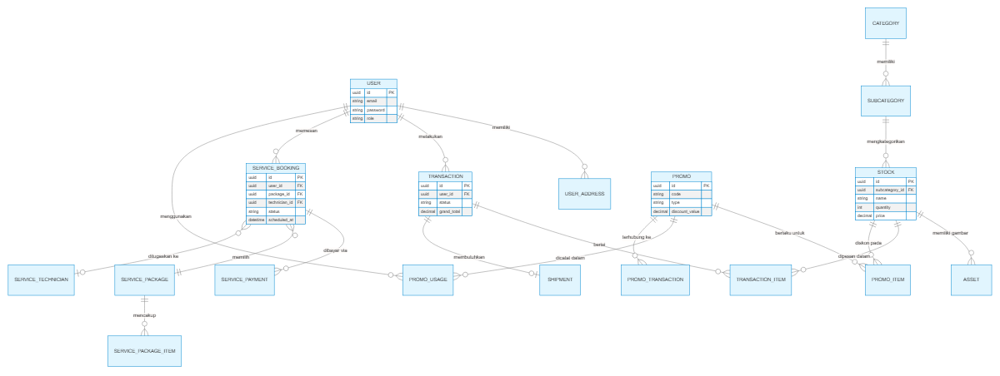

# Skema & Relasi Basis Data (Database Schema)

Arsitektur tumpukan data PasarCCTV ditenagai oleh keandalan **PostgreSQL**, diikat oleh logika ORM modern **SQLAlchemy 2.0** versi *Asynchronous* (`asyncpg`).

## Entity Relationship Diagram (ERD) Tingkat Logika
Berdasarkan fungsionalitasnya, sistem dipilah ke dalam 5 teritori ranah (*domains*):
1. **User Domain**: Otorisasi, Kredensial enkripsi kata sandi, Manajemen sesi, dan Daftar buku alamat majemuk.
2. **Catalog Domain**: Struktur kategori pohon (*Subcategories*), daftar induk (*Stock/Product*), pengelompokkan opsi varian (warna/ukuran), dan relasi *Asset Media* yang disimpan terpisah.
3. **Transaction Domain**: Rekaman statis pesanan keranjang belanja (*Transaction Items*), perhitungan harga konkrit, serta detail rute kurir logistik (*Shipment*).
4. **Service Domain**: Pengelolaan jadwal Jasa Pemasangan & Pemeliharaan CCTV (*Booking*), penempatan teknisi lapangan (*Assignment*).
5. **Promo Domain**: Logika validitas Kupon, diskon temporal (*Flash Sale*), dan log pembukuan (*Promo Usage*).

  
*(Rujukan Arsitektur: Skema ERD Database Marketplace Inti)*

## Pedoman & Konvensi Pengembang (Engineering Rules)
* **Kunci Primer Publik (Public Primary Keys)**: Dilarang keras menggunakan tipe pengenal berurutan (*Auto Increment ID*) untuk tabel yang diekspos keluar. Seluruh modul diwajibkan menggunakan tipe `UUIDv4` untuk *Public ID* guna meminimalisir celah keamanan eskalasi parameter URL berantai (IDOR).
* **Integritas Relasi (Foreign Keys)**: Penghapusan atau modifikasi kunci referensi induk diwajibkan menyertakan *Constraint CASCADE* agar tidak meninggalkan data yatim piatu (*Orphan Rows*), kecuali untuk log transaksi permanen (menggunakan pola *Soft Delete* / *SET NULL*).
* **Sistem Stempel Waktu (Timestamps Audit)**: Tiap model SQLAlchemy ORM otomatis menurunkan/mewarisi modul abstraksi pencatatan `created_at` dan `updated_at`.
