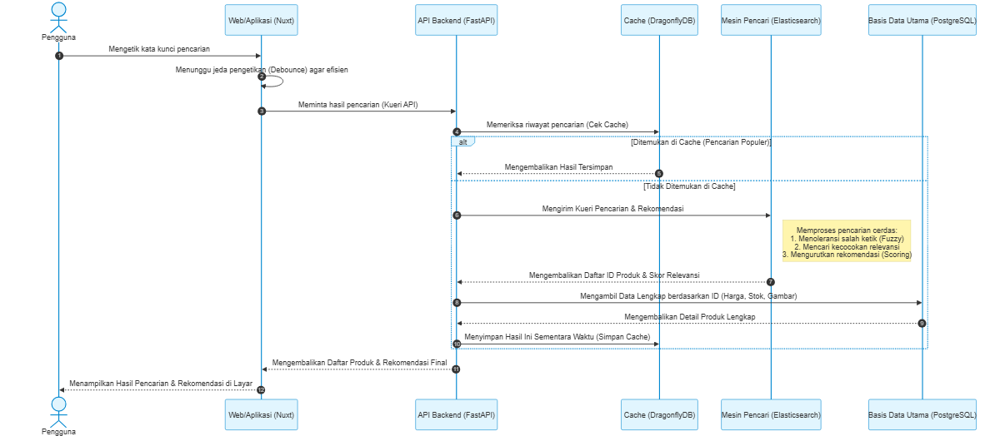

# Sistem Pencarian Lanjutan (Elasticsearch & DragonflyDB Cache)

Modul pencarian di PasarCCTV bukan sekadar kueri `LIKE %...%` di PostgreSQL. Kita mendesain *Search Engine* terpisah berbasis **Elasticsearch** untuk menangani pencarian *fuzzy*, tipografi (salah ketik), dan pemberian skor (*Relevance Scoring*).

## Arsitektur Cache-First

Pencarian yang dilakukan pengguna di antarmuka tidak akan langsung ditembakkan ke basis data. Backend melakukan validasi berjenjang untuk memastikan latensi terendah.

  
*(Lihat Sequence Diagram: Alur Komunikasi Elasticsearch dan DragonflyDB Cache)*

1. **Layer 1: DragonflyDB (Cache)**
   * Sistem akan mencari di dalam cache *in-memory* berkecepatan tinggi terlebih dahulu. Jika ada (Cache Hit), *backend* merespons secara instan.
2. **Layer 2: Elasticsearch (Search Engine)**
   * Jika tidak ada di *cache*, Elasticsearch mencari di dalam datanya, memberikan skor toleransi kata (seperti menoleransi kesalahan ketik pengguna dari "Kbal" menjadi "Kabel"), lalu mengirimkan deretan `ID` produk yang cocok.
3. **Layer 3: PostgreSQL (Data Utama / RDBMS)**
   * Hanya setelah sederetan `ID` didapat, *backend* akan melakukan kueri ringan ke basis data relasional untuk menarik *row* data lengkapnya (seperti Harga, Status Stok, URL Gambar). Data final ini kemudian disematkan kembali ke Layer 1 (Cache) untuk 5 menit ke depan.

## Sinkronisasi Indeks Otomatis (Auto-Sync Mechanism)
Karena PostgreSQL adalah sumber kebenaran data utama (*Source of Truth*), setiap terjadi modifikasi *CRUD* (Pembuatan/Perubahan Produk) oleh Admin, sebuah *background task* akan dipicu secara senyap untuk memperbarui indeks di Elasticsearch tanpa menahan pemuatan halaman admin itu sendiri.
