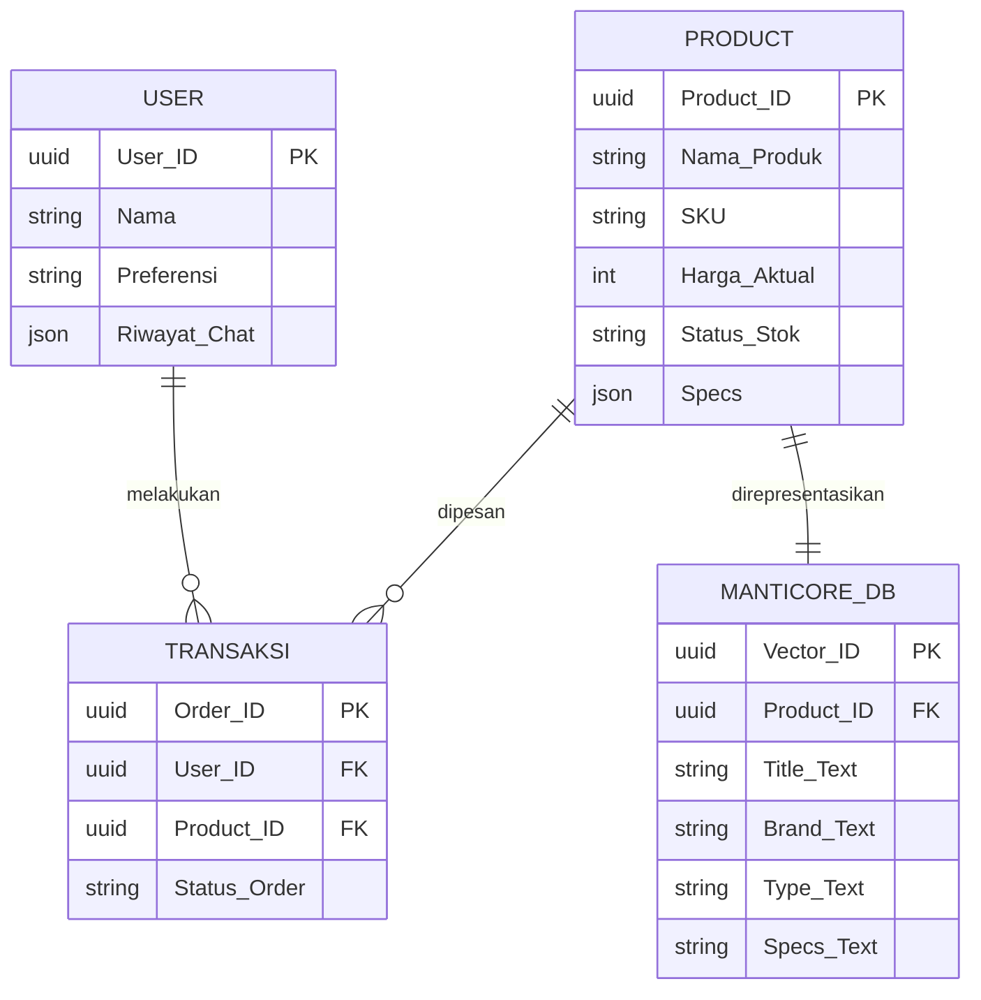
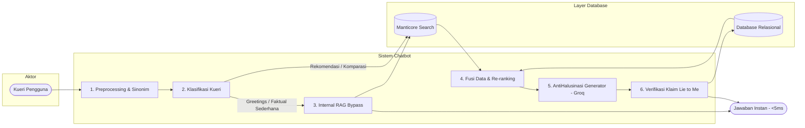

# Alur Kerja & Arsitektur PasarBot RAG (PasarBot Workflow & Architecture)

Dokumen ini menjelaskan alur kerja teknis, struktur database (ERD), dan alur flowchart sistem bagaimana data katalog dicari, diformat, difilter secara lokal (Internal RAG), atau diproses oleh Model Bahasa Besar (LLM) untuk menghasilkan respons yang pintar, relevan, dan **zero-halusinasi** secara real-time.

---

## 1. Entity-Relationship Diagram (ERD) & Struktur Database

Dalam PasarCCTV, data dipisah antara data relasional (relasi absolut untuk harga, stok, spesifikasi) dan data teks terindeks (Manticore Search) untuk pencarian cepat. Hal ini meminimalkan latensi dan mencegah model berhalusinasi tentang harga atau stok aktual.

### Strategi Penyimpanan & Optimasi Memori:
- **Manticore Search Engine (Retrieval):** Digunakan untuk mencari deskripsi, spesifikasi, dan merek produk secara efisien. Dengan arsitektur terkompresi Manticore, pencarian beroperasi secara offline dengan kebutuhan RAM yang sangat kecil (hemat memori dibanding Elasticsearch) namun tetap mempertahankan recall tinggi.
- **Relational DB / Graph Triples:** Digunakan untuk mencatat relasi absolut (contoh: Produk A -> Harga Rp192.000 -> Stok 14). Ini digunakan oleh post-generation verification ("Lie to Me") untuk mendeteksi halusinasi LLM sebelum jawaban dikirim ke pengguna.

---

## 2. Alur Flowchart Sistem (System Flow)

Diagram alur berikut memisahkan aktor, sistem chatbot, dan database dengan tata letak dari kiri ke kanan (Left-to-Right) untuk kejelasan alur data.

---

## 3. Langkah-Langkah Eksekusi Pipeline

### Langkah 1: Preprocessing & Ekstraksi Kata Kunci
- Mengambil kueri teks dari pengguna (contoh: *"berapa harga cctv tapo?"* atau *"rekomendasikan kamera outdoor 5mp"*).
- Menghapus stopwords dan melakukan ekspansi sinonim leksikal menggunakan kamus lokal (`SYNONYMS_DICT`).

### Langkah 2: Klasifikasi Kueri & Strategi Bypass Lokal (Internal RAG)
- **Greeting Bypass:** Kueri penyapaan murni (*"halo"*, *"hi"*, dsb) dijawab secara instan menggunakan template lokal + menyertakan 3 produk terpopuler dari database.
- **Factual Bypass:** Kueri yang menanyakan harga, stok, atau spesifikasi secara spesifik (*"ready?"*, *"berapa harganya?"*, *"resolusi berapa?"*) akan langsung ditarik dari Manticore Search dan diformat menjadi teks jawaban presisi secara lokal. 
- **Hasil:** Mengurangi biaya token API Groq dan memberikan latensi sangat rendah (<5ms).

### Langkah 3: Multi-Stage Hybrid Search & Re-ranking (RRF)
- Untuk kueri rekomendasi/komparasi, sistem melakukan pencarian full-text Manticore dengan fallback multi-tahap (Strict AND -> Loose OR -> Prefix Wildcard).
- Menggunakan formula pembobotan kustom berbasis kemiripan teks, tingkat diskon, dan popularitas penjualan (`terjual`).

### Langkah 4: Knowledge Graph (KG) & Prompt Generation
- Membangun sub-grafik relasi (triples) secara real-time dari metadata produk untuk memperkuat logika reasoning model.
- Mengirim pesan dengan system instruction berbasis protokol **CURE XML tags** (`<think>`, `<decompose>`, `<reply>`) ke **Groq API** (`openai/gpt-oss-120b`).

### Langkah 5: Post-Generation Claim Verification ("Lie to Me")
- Draf jawaban LLM dianalisis menggunakan ekspresi reguler terhadap database relasional aktual.
- Jika ditemukan salah tulis harga atau klaim merek palsu, sistem mendeteksi halusinasi tersebut secara mandiri dan memperbaikinya sesuai data asli sebelum dikirim ke frontend.

---

## 4. Asumsi & Skalabilitas Sistem

- **Asumsi Konektivitas:** Groq API diakses dengan timeout 15 detik. Jika terjadi kegagalan jaringan atau limit kuota, sistem secara otomatis beralih ke *local fallback summarizer* berbasis pencarian Manticore untuk menjamin layanan 100% online.
- **Skalabilitas Vektor & Teks:** Penggunaan Manticore Search menggantikan Elasticsearch secara penuh menurunkan penggunaan memory footprint (SRAM/RAM) hingga 80%, memungkinkan deploy pada mesin VPS kecil/hemat biaya.
