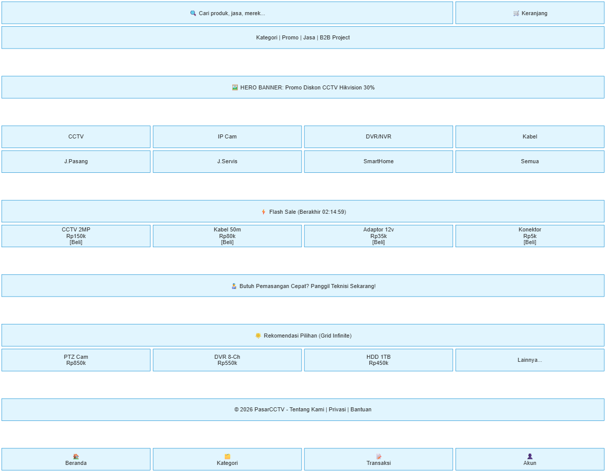

# Sistem Desain & Estetika (Design System)

Frontend PasarCCTV mengadopsi identitas visual *Premium B2B Marketplace*. Antarmuka dirancang untuk memfasilitasi audiens yang luas: teknisi lapangan, pemilik proyek berskala besar, maupun pelanggan ritel biasa, tanpa mengorbankan kecepatan dan kemudahan bernavigasi.

## Karakteristik Estetika BOLD
Sistem kami memegang prinsip:
1. **Warna Tema (Color Palette)**: Menggunakan warna dasar *Dark Forest Green* dengan aksen keemasan tipis. Tampilan harus terasa mahal, rapi, dan mampu menumbuhkan rasa percaya (*trust*) seketika.
2. **Glassmorphism**: Digunakan secara bijak (dengan kelas `backdrop-blur`) pada navigasi melayang (*sticky navigation*) agar antarmuka terasa modern, elegan, dan tidak membuat layar ponsel terasa sesak.
3. **Tipografi**: Penggunaan keluarga *font* modern seperti Inter, Roboto, atau Space Grotesk.
4. **Ruang Negatif (Spatial Composition)**: Setiap kartu produk (*Product Cards*) diatur dengan batasan ruang (*padding* & *margin*) yang lapang, memisahkan hirarki visual secara elegan.

## Implementasi Tailwind CSS v4
Kami menggunakan utilitas bawaan Tailwind CSS v4 yang dikonfigurasi secara langsung melalui sistem modul Nuxt / Vite.

### Panduan Komponen (Komponen UI Kritis)
Saat merancang halaman `.vue` baru, patuhi aturan antarmuka berikut:
* **Pencarian Agresif (Top Search Bar)**: Kotak pencarian tidak boleh tersembunyi. Ia harus *sticky* (menempel di atas), karena transaksi *marketplace* B2B sangat bertumpu pada kecepatan mancari *part* teknis melalui kotak penelusuran.
* **Ikon Kategori Tumpul (Rounded Icons)**: Menggunakan sudut membulat untuk memperkuat interaksi di perangkat ponsel layar sentuh (*Touch-Friendly*).
* **Pemisahan Jasa/Layanan (Separation of Concerns)**: Opsi pemesanan jasa ("Pesan Teknisi") wajib divisualisasikan dengan blok *Banner Call-to-Action* (CTA) besar menyamping agar tidak bercampur visualnya dengan katalog ritel barang fisik.

  
*(Referensi Estetika: Premium High-Fidelity UI Homepage)*
