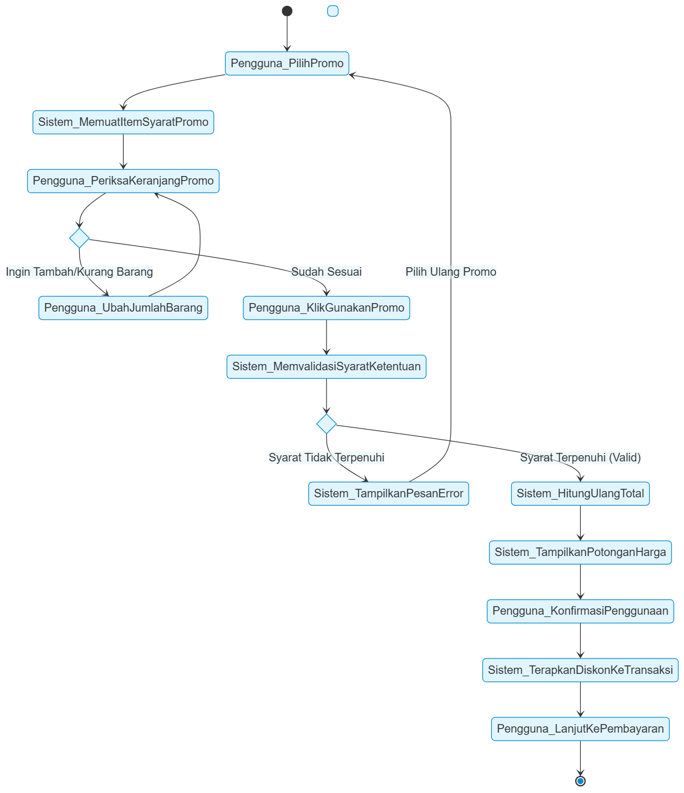

# Manajemen Status (State Management) dengan Pinia

Karena platform PasarCCTV menangani alur *e-commerce* dan *service booking* (jasa teknisi) yang sangat kompleks, sistem tidak bisa hanya mengandalkan *state* komponen Vue biasa. Kami mendistribusikan tata kelola data reaktif melalui **Pinia**.

## Modul Store Utama
Seluruh gudang penyimpanan (*stores*) didefinisikan di dalam direktori `app/stores/`. Modul paling krusial meliputi:

### 1. `useCheckoutStore` (`checkout.ts`)
Store ini bertanggung jawab mutlak atas perhitungan uang (*money-math*) dan dimensi fisik pesanan.
* **Tanggung Jawab**: Menyimpan keranjang belanja (*cart items*), opsi tambahan peralatan (*addons*).
* **Kalkulasi Reaktif (Getters)**: Menghitung akumulasi berat total pesanan (untuk perhitungan biaya kurir), `subtotal`, dan pemotongan harga (diskon).
* **Getters Kunci**: `grandTotal` akan selalu secara otomatis mengembalikan nilai dari `subtotal` dikurangi dengan `discountPromo` yang divalidasi.

### 2. `usePromoStore` (`promo.ts`)
Menangani alur validasi matematis dan penerapan kupon promo (seperti *Cashback* atau Diskon Pembelian Grosir).
* Secara intensif melakukan panggilan (*fetch*) ke API Nitro di rute `/promos/validate`.
* Mampu mengambil (*pre-populate*) `item_uuid` langsung dari syarat promo tanpa mengharuskan pengguna mengetiknya berulang kali.

  
*(Diagram Arsitektur: Alur Validasi Promo di Sistem Pinia)*

### 3. `useNotificationStore`
Modul ringan namun vital yang menampung aliran data konstan (*stream*) yang dikirimkan oleh WebSocket FastAPI (`useNotificationSocket`). Store ini bertugas membangunkan komponen UI (seperti munculnya *Toast/Snackbars*) ketika notifikasi baru (misalnya "Pembayaran Berhasil" atau "Teknisi Tiba") masuk ke sistem secara seketika.
